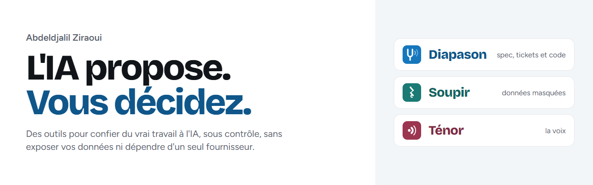

<picture>
  <source media="(prefers-color-scheme: dark)" srcset="assets/header-dark.png">
  
</picture>

  
  
  

Je construis des outils qui font entrer l'IA dans le quotidien d'une équipe, sans lui laisser le dernier mot.

<table>
  <tr>
    <td width="72" align="center"></td>
    <td><strong>Diapason</strong> accorde la spec, les tickets et le code. Claude lit les outils de l'équipe, repère les écarts et propose un patch, qui est vérifié, relu, puis envoyé par une personne.</td>
  </tr>
  <tr>
    <td align="center"></td>
    <td><strong>Soupir</strong> pose le silence sur les données sensibles. Personnes, clients, secrets et serveurs sont masqués avant que l'IA ne lise un document, puis rétablis dans la réponse.</td>
  </tr>
  <tr>
    <td align="center"></td>
    <td><strong>Ténor</strong> donne une voix aux applications. Les phrases sont enregistrées une fois, écoutées et validées par une personne, puis servies aux applications.</td>
  </tr>
</table>

**Le trajet d'un changement** : `Scan` → `Patch` → `Check` → `Review` → `Push`. Claude propose, une personne relit et envoie. Rien ne part sans elle.

**Souverain, sans fournisseur imposé.** Les outils s'installent chez vous, et le modèle n'est pas figé : Claude aujourd'hui, demain OpenAI, Mistral ou un autre, selon vos règles. Ils se branchent sur les outils de l'équipe, par exemple Jira, Confluence, Bitbucket, GitHub ou Mantis, et d'autres selon les besoins.

> « Quand on n'a pas le temps de bien faire les choses, on aura le temps de les refaire. »

Logiciels d'entreprise depuis 2018 · .NET · TypeScript · Angular · React · Azure

<strong>English</strong>

 

**The AI proposes. You decide.**

I build tools that bring AI into a team's daily work without giving it the last word.

- **Diapason** keeps spec, tickets and code in tune. Claude reads the team's tools, finds the gaps and proposes a patch that is checked, reviewed, then sent by a person.
- **Soupir** lays silence over sensitive data. People, clients, secrets and servers are masked before the AI reads a document, then restored in the answer.
- **Ténor** gives applications a voice. Phrases are recorded once, listened to and approved by a person, then served to applications.

**Sovereign, no imposed provider.** The tools run on your side, and the model is not fixed: Claude today, OpenAI, Mistral or another tomorrow, under your rules.

> "When you have no time to do things well, you will have time to do them again."

[abdeldjalil.ziraoui.dev](https://abdeldjalil.ziraoui.dev/?lang=en) · [LinkedIn](https://www.linkedin.com/in/abdeldjalil-ziraoui) · abdeldjalil.ziraoui@gmail.com

